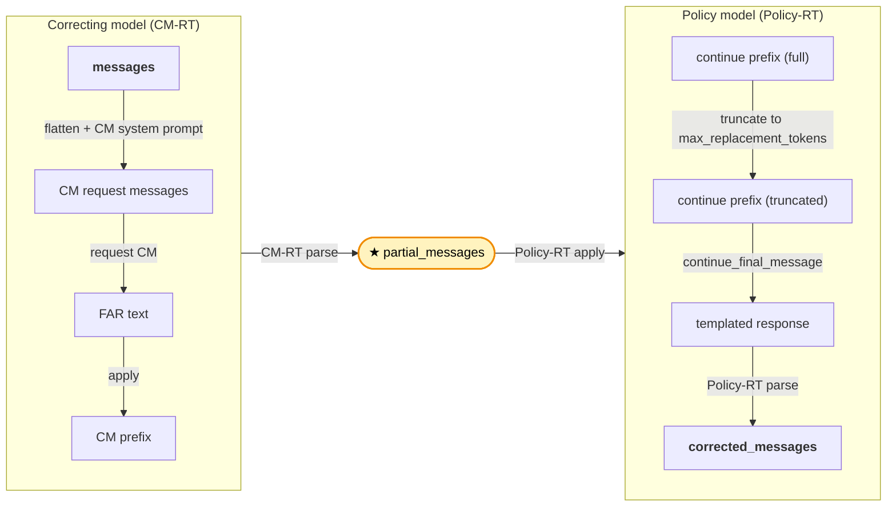

# `onpanda`: The Companion Python Package for onPanda

Python package for *onPanda: Efficient Annotation of On-Policy Alignment Data for LLMs and Agents via Token-Level Correction* [[project page](https://on-panda.github.io/research/)]

### Contents: [Features](#-features) | [Install](#-install) | [Example Data](#-example-data) | [Quick Start](#-quick-start) | [Main Modules](#-main-modules) | [Iterative Correction](#-iterative-correction-one-step) | [Iterative Correction API](#-iterative-correction-api) | [Data Assumptions](#-data-assumptions)

## ▮ Features
- [x] Parse `.panda.json` into SFT and preference-pair data (`build_legacy_data_v1`)
- [x] Build token-level supervision data (`build_token_level_supervision_data_v1/v2`)
- [x] Build Find-and-Replace correction training data (`build_far_correction_data_v1`)
- [x] Token-level correcting on the reasoning and tool call channels, not only content
- [x] Verify trajectory corrections (`CorrectionVerifier`)
- [x] Benchmark [Panda-CVL dataset](https://on-panda.github.io/Panda-CVL/)
- [x] Run iterative correction as a Proxy API (`onpanda.server.iterative_correction_api`)
- [x] Build `panda battle` data from two arena result sets (`build_panda_battle`)

## ▮ Install

```bash
pip install onpanda -U

# Or want to run demos.
git clone https://github.com/on-panda/on-panda-python.git
pip install -e ./on-panda-python

# Example Data for demo
git clone https://github.com/on-panda/on-panda-example-data.git
ls on-panda-example-data/panda_json/
```

If you want to use tokenizers, install `transformers` separately.

## ▮ Quick Start

```python
import onpanda

panda_path = (
    "../on-panda-example-data/panda_json/"
    "2025-08-19_how-many-1s_tokenizer-Qwen2.5.panda.json"
)
tokenizer=onpanda.utf8_tokenizer
# Use built-in utf8_tokenizer for a minimal runnable flow.
tree = onpanda.PandaTree(panda_path, tokenizer)

# 1) SFT + preference pairs
legacy = tree.build_legacy_data_v1()
print("sfts:", len(legacy["sfts"]))
print("preferences:", len(legacy["preferences"]))

# 2) Token-level supervision
token_level_v1 = tree.build_token_level_supervision_data_v1(
    tokenizer
)
print("token_level_v1:", len(token_level_v1))

# 3) Find-and-Replace correction data
adapter = onpanda.FindAndReplaceCorrectionAdapter(
    tokenizer
)
correction_data = tree.build_far_correction_data_v1(adapter)
print("correction_data:", len(correction_data))
```

Build from plain chat messages:

```python
import onpanda

messages = [
    {"role": "user", "content": "5+7=?"},
    {"role": "assistant", "content": "12"},
]
panda_json = onpanda.messages_to_panda_tree(messages, uuid="demo")
# dump to xxx.panda.json
```

## ▮ Main Modules

- `onpanda/parser.py`: `PandaTree` and data conversion entrypoints
- `onpanda/response_templates/`: `apply`/`parse` between an assistant message and the model's own response text, so correcting reaches the reasoning and tool call channels
- `onpanda/token_level_supervision_utils.py`: token-level patch extraction and masks
- `onpanda/correcting_model/far_correction_utils.py`: FAR data builder and apply logic
- `onpanda/correcting_model/far_text_parse.py`: FAR parser/locator/reward computation
- `onpanda/correcting_model/verifier.py`: trajectory correction verification
- `onpanda/correcting_model/panda_score_mixin.py`: evaluation correction ability on Panda JSON
- `onpanda/correcting_model/correcting_model.py`: iterative correction workflow
- `onpanda/server/iterative_correction_api.py`: Flask wrapper for correction service
- `onpanda/arena/panda_battle.py`: build battle-style comparison data

## ▮ Iterative Correction: One Step
`CorrectingModel.iterative_correction` repeats one correction step (`correct_and_rollout`) until the correcting model (CM) answers `is_good` or `rollout_num` runs out. In each step, the CM points out where the policy response goes wrong with a Find-and-Replace (FAR) correction, then the policy model continues its own response from the corrected prefix.



- **CM-RT / Policy-RT**: the response templates of the CM and the policy model. `apply` renders a message into templated text, and `parse` turns the text back into a message. The two templates can differ, so the correction is made in CM-RT text and continued in Policy-RT text.
- **FAR text**: `<|split|>location_text<|split|>location_index<|split|>replacement_token<|split|>`. Applying it finds the `location_index`-th `location_text` in the CM-RT templated assistant messages, cuts the text there, and appends `replacement_token` to get the CM prefix.
- **★ `partial_messages`**: `messages[:fork_message_index] + [partial_message]`, the template-independent bridge between the two models. The replacement can end any channel (reasoning, content or a tool call), and everything after it is dropped.
- **Truncation**: the policy cannot continue from half a token, so the full prefix is cut with the policy tokenizer. It is compared with the rejected message token by token, and only `max_replacement_tokens` tokens are kept after their fork, extended to the next decodable boundary.
- **Default CM-RT markers**: `<|reasoning|>` is a special token configurable through `special_tokens`, like `<|split|>`, `<|stop|>` and `<|is_good|>`, so a tokenizer-aware CM can map it to one token of its own vocabulary. `<|tool_calls|>` is a fixed marker.
- **Not drawn**: `is_good` keeps `messages` and ends the iteration. A FAR that cannot be parsed or located is retried up to `max_correction_attempts` times, then the response is regenerated. A correction that already ends the message skips the policy request.

## ▮ Iterative Correction API
Launch a proxy API server that return response using iterative_correction
```bash
python -m onpanda.server.iterative_correction_api --help
```

## ▮ Data Assumptions
- `PandaTree` is a parser for qualified, annotated Panda JSON.
- `PandaTree` preprocessing currently assumes:
    - Top-level field `dialogs` exists
    - Top-level field `update_time` exists
    - At least one dialog ends with an `assistant` message
    - If `annotate.is_good` is missing, latest dialog is treated as default good
