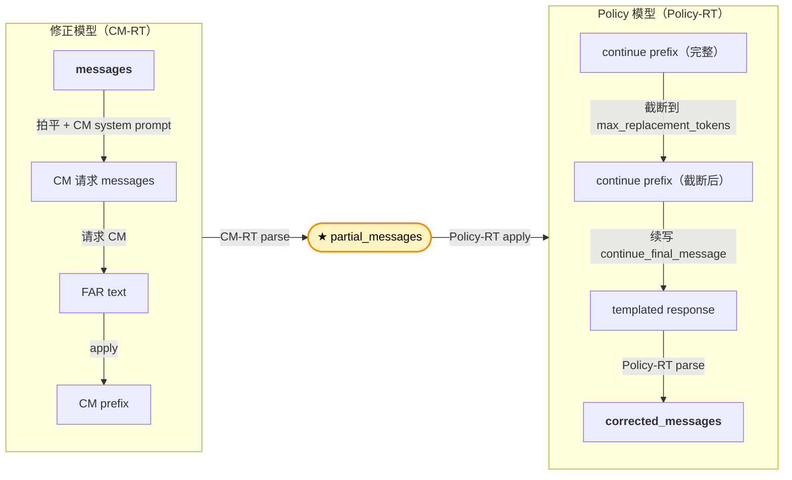

# `onpanda`：onPanda 配套 Python 包

[English](README.md) | 中文

*onPanda: Efficient Annotation of On-Policy Alignment Data for LLMs and Agents via Token-Level Correction* 的 Python 包 [[项目主页](https://on-panda.github.io/research/)]

### 目录：[功能](#-功能) | [安装](#-安装) | [示例数据](#-示例数据) | [快速上手](#-快速上手) | [主要模块](#-主要模块) | [迭代修正](#-迭代修正单步) | [迭代修正 API](#-迭代修正-api) | [数据假设](#-数据假设) | [资源](#-资源)

## ▮ 功能
- [x] 将 `.panda.json` 解析为 SFT 和偏好对数据（`build_legacy_data_v1`）
- [x] 构建 token-level 监督数据（`build_token_level_supervision_data_v1/v2`）
- [x] 构建 Find-and-Replace 修正训练数据（`build_far_correction_data_v1`）
- [x] token-level 修正不止覆盖 content，也覆盖 reasoning 和 tool call 通道
- [x] 验证 trajectory 的修正（`CorrectionVerifier`）
- [x] 评测 [Panda-CVL 数据集](https://on-panda.github.io/Panda-CVL/)
- [x] 以 Proxy API 的形式运行迭代修正（`onpanda.server.iterative_correction_api`）
- [x] 从两组 arena 结果构建 `panda battle` 数据（`build_panda_battle`）

## ▮ 安装

```bash
pip install onpanda -U

# 或者，想运行 demo
git clone https://github.com/on-panda/on-panda-python.git
pip install -e ./on-panda-python

# demo 用的示例数据
git clone https://github.com/on-panda/on-panda-example-data.git
ls on-panda-example-data/panda_json/
```

如需使用 tokenizer，请另行安装 `transformers`。

## ▮ 快速上手

```python
import onpanda

panda_path = (
    "../on-panda-example-data/panda_json/"
    "2025-08-19_how-many-1s_tokenizer-Qwen2.5.panda.json"
)
tokenizer=onpanda.utf8_tokenizer
# 用内置的 utf8_tokenizer 跑通最小流程
tree = onpanda.PandaTree(panda_path, tokenizer)

# 1) SFT + 偏好对
legacy = tree.build_legacy_data_v1()
print("sfts:", len(legacy["sfts"]))
print("preferences:", len(legacy["preferences"]))

# 2) Token-level 监督
token_level_v1 = tree.build_token_level_supervision_data_v1(
    tokenizer
)
print("token_level_v1:", len(token_level_v1))

# 3) Find-and-Replace 修正数据
adapter = onpanda.FindAndReplaceCorrectionAdapter(tokenizer)
correction_data = tree.build_far_correction_data_v1(adapter)
print("correction_data:", len(correction_data))
```

从普通的 chat messages 构建：

```python
import onpanda

messages = [
    {"role": "user", "content": "5+7=?"},
    {"role": "assistant", "content": "12"},
]
panda_json = onpanda.messages_to_panda_tree(messages, uuid="demo")
# 保存为 xxx.panda.json
```

## ▮ 主要模块

- `onpanda/parser.py`：`PandaTree` 和数据转换入口
- `onpanda/token_level_supervision_utils.py`：token-level patch 提取和 mask
- `onpanda/correcting_model/far_correction_utils.py`：FAR 数据构建和 apply 逻辑
- `onpanda/correcting_model/far_text_parse.py`：FAR 解析、定位和 reward 计算
- `onpanda/correcting_model/verifier.py`：trajectory 修正验证
- `onpanda/correcting_model/panda_score_mixin.py`：在 Panda JSON 上评测修正能力
- `onpanda/correcting_model/correcting_model.py`：迭代修正流程
- `onpanda/server/iterative_correction_api.py`：修正服务的 Flask 封装
- `onpanda/arena/panda_battle.py`：构建 battle 式的对比数据

## ▮ 迭代修正：单步
`CorrectingModel.iterative_correction` 会重复执行单步修正（`correct_and_rollout`），直到修正模型（correcting model，CM）回答 `is_good`，或用完 `rollout_num`。每一步里，CM 先用一条 Find-and-Replace（FAR）修正指出 policy 回答出错的位置，再由 policy 模型从修正后的前缀续写自己的回答。



- **CM-RT / Policy-RT**：CM 和 policy 模型各自的 response template。`apply` 把 message 渲染成 templated 文本，`parse` 再把文本解析回 message。两者可以不同，所以修正在 CM-RT 文本上完成，续写在 Policy-RT 文本上进行。
- **FAR text**：`<|split|>location_text<|split|>location_index<|split|>replacement_token<|split|>`。apply 时，在 CM-RT 渲染后的 assistant messages 中找到第 `location_index` 个 `location_text`，在该处截断，再拼上 `replacement_token`，得到 CM prefix。
- **★ `partial_messages`**：`messages[:fork_message_index] + [partial_message]`，是两个模型之间与模板无关的桥梁。replacement 可以结束任意通道（reasoning、content 或某个 tool call），其后的内容全部丢弃。
- **截断**：policy 无法从半个 token 接着续写，所以要用 policy 的 tokenizer 截断完整前缀：先和 rejected message 逐 token 比较，在分叉点之后只保留 `max_replacement_tokens` 个 token，并延伸到下一个可解码的边界。
- **默认 CM-RT 的 marker**：`<|reasoning|>` 和 `<|split|>`、`<|stop|>`、`<|is_good|>` 一样，是可以通过 `special_tokens` 配置的特殊 token，tokenizer-aware 的 CM 可以把它映射为自己词表里的单个 token。`<|tool_calls|>` 则是固定的 marker。
- **图中未画出**：`is_good` 时保留 `messages` 并结束迭代。FAR 无法解析或定位时，最多重试 `max_correction_attempts` 次，仍失败则重新生成回答。如果修正本身已经结束了这条 message，就跳过 policy 的续写请求。

## ▮ 迭代修正 API
启动一个代理 API 服务，返回经 iterative_correction 得到的回答
```bash
python -m onpanda.server.iterative_correction_api --help
```

## ▮ 数据假设
- `PandaTree` 是面向合格的、已标注的 Panda JSON 的解析器。
- `PandaTree` 的预处理目前假设：
    - 存在顶层字段 `dialogs`
    - 存在顶层字段 `update_time`
    - 至少有一个 dialog 以 `assistant` message 结尾
    - 若缺少 `annotate.is_good`，最新的 dialog 默认视为 good

## ▮ 资源

- [onPanda](https://github.com/on-panda/on-panda)：在 token 级别操控 LLM 和 agent 的 Web 应用，本包解析的 `.panda.json` 数据即由它标注，可 [在线体验](https://onpanda.diyer22.com/)。
- 批量标注 LLM 数据或者 agent 轨迹请参阅 [研究页面](https://on-panda.github.io/research/) 和 [packages/annotate](https://github.com/on-panda/on-panda/blob/main/packages/annotate/README.md)。
- [on-panda-example-data](https://github.com/on-panda/on-panda-example-data)：demo 用的 `.panda.json` 示例数据。
- [on-panda-docs](https://github.com/on-panda/on-panda-docs)：onPanda 开发文档，包括 [`.panda.json` 数据格式规范](https://github.com/on-panda/on-panda-docs/blob/main/content/zh-cn/panda_json_format.md)。
